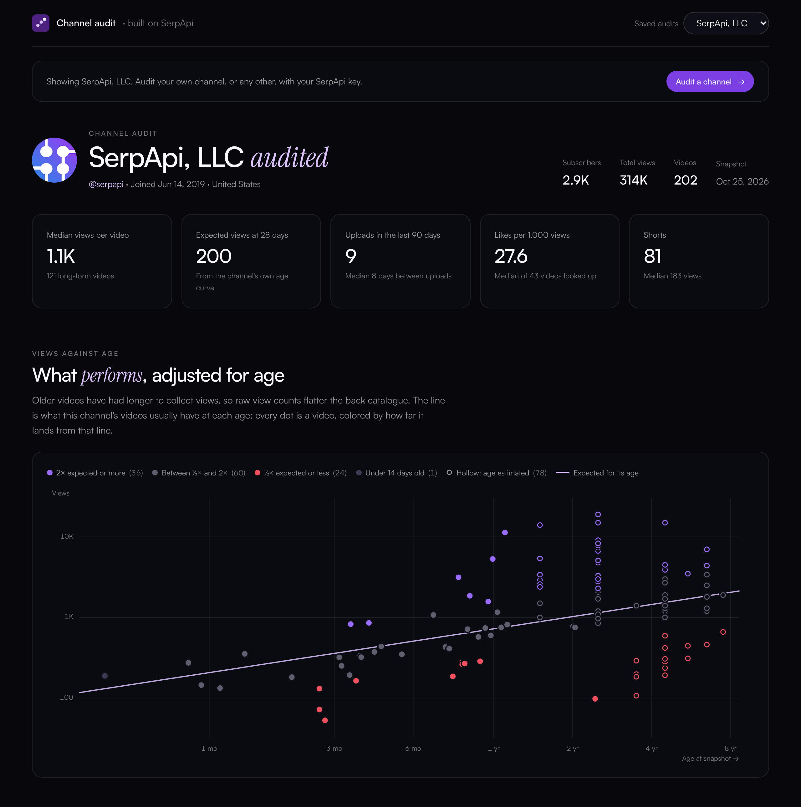

# YouTube channel audit

Point it at any YouTube channel and it lists every upload through [SerpApi](https://serpapi.com)'s YouTube engines, scores each video against what that channel usually gets at the same age, and shortlists the weak videos worth remaking. It runs on your machine with your own SerpApi key.



It answers four questions:

1. Which videos beat the channel's normal curve, and which fell short of it?
2. Which topics, lengths and title patterns go with the stronger videos?
3. Which weak videos sit on a topic where other creators get far more views? That's the remake shortlist.
4. For the one you pick, what does the brief look like? The dashboard drafts it with the data filled in and the creative parts (ICP, script, visuals) left as visible `[TO WRITE]` placeholders.

## Quick start

You need Node 22 or newer and a SerpApi key ([the free plan](https://serpapi.com/pricing) works; get the key at [serpapi.com/manage-api-key](https://serpapi.com/manage-api-key)).

```bash
git clone https://github.com/kevinblanco/serpapi-youtube
cd serpapi-youtube
npm install
cp .env.example .env        # Windows: copy .env.example .env
```

Open `.env`, paste your key after `SERPAPI_API_KEY=`, then:

```bash
npm run dev
```

Open http://localhost:5173. It starts on a sample audit of SerpApi's own channel (`data/audits/serpapi.json`, taken October 25, 2026), so you can look around before spending anything.

## Audit your channel

Click **Audit a channel** at the top of the dashboard and enter the channel any of these ways:

- its handle: `@yourchannel`
- its URL: `https://www.youtube.com/@yourchannel`
- its channel id: `UC…` (on the channel page, About, then Share channel, then Copy channel ID)

Old `/c/` and `/user/` links can't be looked up, so use the handle or the id for those channels. The panel shows an estimate of the searches the audit will spend next to the searches you have left, then streams progress into the page while it runs. Each finished audit is saved in `data/audits/`, and a menu in the top bar switches between them.

The same pipeline runs from the terminal:

```bash
npm run audit -- @yourchannel
npm run audit -- @yourchannel --estimate                          # print the cost and stop
npm run audit -- @yourchannel --enrich 10 --demand 2 --videos-only   # a cheaper run
npm run audit -- --help
```

To run the dashboard and the API together on one port, use `npm start`. It builds the dashboard, then serves both on http://localhost:8787.

## What an audit costs

Every SerpApi call is one search from your monthly allowance. The [free plan](https://serpapi.com/pricing) has 250 a month and a throughput limit of 50 an hour.

| Channel size | Default settings | `--enrich 10 --demand 2 --videos-only` |
|---|---|---|
| 50 videos | about 64 searches | about 22 |
| 200 videos | about 69 | about 27 |
| 600 or more | about 82 | about 40 |

Most of the default cost is the 40 individual video lookups ("Video lookups" in the dashboard, `--enrich` in the terminal). The estimate is an upper bound: tabs often end early, and every response is cached in `data/cache/`, so running the same audit again costs nothing. Tick "Skip local cache" (or pass `--refresh`) when you want fresh numbers. On the free plan, start with the cheaper settings; a default audit can go past 50 searches in an hour, and a later run picks up whatever was already cached.

Checking your remaining searches is free, since SerpApi doesn't bill the Account API.

## Where SerpApi comes in

| Step | Engine | Searches |
|---|---|---|
| Channel details: subscribers, total views, join date, and the first 30 videos | [`youtube_channel`](https://serpapi.com/youtube-channel-api) with `about=true` | 1 |
| Every other upload, following `serpapi_pagination.next` | `youtube_channel`, then `tab=shorts` and `tab=streams` | 1 per page |
| Exact publish date, likes, chapters, description | [`youtube_video`](https://serpapi.com/youtube-video-api) | 1 per video, you choose how many |
| Topic demand: what ranks for a weak video's subject, and how many views it has | [`youtube`](https://serpapi.com/youtube-search-api) (search) | 1 per candidate |
| The first minute of a video, word for word | [`youtube_video_transcript`](https://serpapi.com/youtube-video-transcript) | 1, when you click |

## How performance is measured

Raw view counts favor old videos, because they've had longer to collect views. So each long-form video is compared with what this channel's videos usually have at the same age:

- The expectation is a straight line through `log(views)` against `log(age in days)`, fitted on regular uploads older than 14 days. It uses the Theil-Sen method (the median of every pairwise slope), so one viral video can't bend the line the way it bends least squares.
- **Performance = views ÷ expected views.** 2× or more is a clear win, 0.5× or less a clear miss. Videos under 14 days old aren't judged yet.
- Shorts and live streams follow different curves, so they stay out of the fit and are reported on their own.

A remake candidate must be at least 60 days old and below 1×. Its score is in doublings: how many times it would need to double to reach its expected views, plus (after a topic search) how many times the median competing video out-views it, capped at 6, minus 1 if it already ranks in the top 3 for that search. You can edit the search query for any candidate before spending a search on it.

Topics come from the titles themselves, not a hand-written list: recurring phrases of one to three words that don't cross a stopword, with the longer phrase kept when it covers most of the shorter one's videos.

## Your key and your searches stay local

- `.env` is gitignored. Only `.env.example` is committed.
- The browser never sees the key. The dashboard talks to the local API, and only the API talks to SerpApi.
- The API listens on `127.0.0.1` only.
- It also refuses requests from other websites. Any page open in your browser can send requests to `localhost`, so without a check a malicious page could start audits and spend your searches. The API answers only when the `Host` is localhost (which blocks DNS rebinding), when the browser's `Origin` and `Sec-Fetch-Site` headers say the request came from the dashboard itself, and, for anything that spends a search, when the body is JSON. Local tools such as `curl` and the CLI still work.
- The key is stripped from everything written to `data/cache/`, from error messages, and from the Account API response (which echoes it back along with your email; the email is dropped too).

## Two things this hit in the YouTube Channel API

Both showed up on the first real run against `@serpapi` (October 2026), and the pipeline works around them:

1. `channel_id=UCUgIHlYBOD3yA3yDIRhg_mg&tab=videos` answers `"videos_results_state": "This channel doesn't have any videos"`, with or without `sort`, although the channel has 121. The same id works for `tab=shorts`, and the handle (`channel_id=serpapi`) works for videos. The pipeline sends whatever identifier the first call succeeded with.
2. After an `about=true` page, `serpapi_pagination.next` keeps `about=true` next to the `next_page_token`, and following it returns HTTP 400: "`about` and `next_page_token` parameters can't be used together." The pipeline follows the `next` link without `about`.

## Limits

- Public data only. Watch time, retention, click-through rate and traffic sources live in YouTube Studio, and the brief lists them as metrics to pull from there.
- Scores, topics and the remake shortlist cover long-form videos. Shorts and live streams are listed and counted but not scored, so a channel that only posts Shorts gets little out of it.
- Each tab is read up to 20 pages (about 30 videos a page) by default. Pass `--pages` up to 50 in the terminal for bigger channels.
- Videos you don't look up individually get their age from YouTube's relative label ("2 years ago"), which is coarse. The scatter plot draws those as hollow dots, and the table marks them.
- Views are a snapshot taken at audit time.
- Comment counts aren't part of the `youtube_video` response (they come from a separate comments request), so the audit leaves them out rather than spending a search per video.
- The stopword list behind topics is English, so topics on channels in other languages come out noisier.
- A topic search measures what ranks for a query, not whether those videos answer the same need. On SerpApi's channel, "scrape youtube shorts" returned Shorts growth tutorials with 300K views, which says nothing about demand for scraping. Open the top results before trusting the number.
- Topic and title results are correlations within one channel's catalogue, not causes.
- A topic search reflects one moment, one country and one language (`gl`, `hl`).

## Share a read-only copy

```bash
npm run snapshot -- yourchannel dist/snapshot.html
```

That writes one self-contained HTML file with a saved audit (named as in `data/audits/`), any transcripts already fetched, and the thumbnails embedded. It spends no searches, needs no server, and hides the buttons that call SerpApi.

## Troubleshooting

- **"SERPAPI_API_KEY is missing"**: `.env` must sit in the project root, next to `package.json`. Restart `npm run dev` after editing it.
- **Port 8787 is taken**: set `PORT=` in `.env` to another port. The dashboard's dev server follows it.
- **Behind a corporate proxy**: Node 22 ignores `HTTPS_PROXY` unless you also set `NODE_USE_ENV_PROXY=1`.
- **"This channel doesn't have any videos"** for a channel that has some: try its handle instead of its `UC…` id (see the API notes above).

## Project layout

```
lib/       analysis shared by server and dashboard: parsing, the age model, topics, candidates, brief
server/    SerpApi client with cache and redaction, the audit pipeline, the local API (Hono)
cli/       the terminal version of "Run audit"
scripts/   the read-only snapshot build
web/       the dashboard (React, Vite, hand-drawn SVG charts)
test/      unit tests, the API's localhost guard, and a full pipeline run against a synthetic channel
data/      cached responses and your saved audits, both local only (the sample audit is the one file committed)
```

## Tests

```bash
npm test
npm run typecheck
```

The pipeline test runs a complete audit against a stub client that serves a made-up channel in SerpApi's response shapes, so it checks paging, lookups, scoring and the brief without spending a search. CI runs the same checks plus the build on every push.

## License

[MIT](LICENSE)
